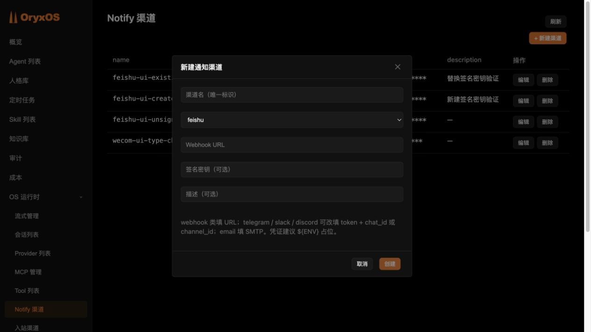
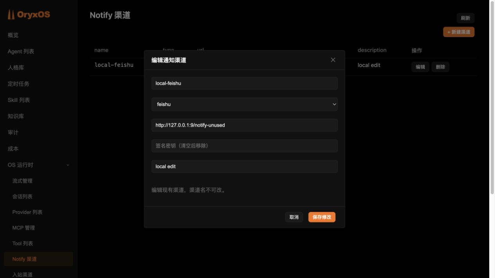

[toc]

# 第二周第二题：飞书签名密钥修复与 PR 实操记录

> 日期：2026-10-27。
>
> 本文记录实际发现问题、编写回归测试、修复、验收和提交的过程。用户已完成手动本地测试并确认通过，最终提交 `f939b188` 的完整 31 模块检查通过，已推送个人 Fork 并创建上游 [PR #1050](https://github.com/oryx-labs/oryxos/pull/1050)。当前等待维护者批准工作流及审查，尚未合并；最终结果见第九节。

## 一、为什么这个问题适合作为 PR

第一题创建飞书通知渠道时，发现管理台无法填写机器人签名密钥，只能通过 API 提交 `config.secret`。

随后检查编辑保存流程，发现已有的签名密钥还可能被清空：即使只修改描述，旧表单也不会提交签名配置，后端会用空配置覆盖原配置，导致启用签名校验的机器人后续发送失败。

这两个现象属于同一条功能链路，适合合并为一个范围明确的修复 PR：**支持在飞书通知渠道表单填写签名密钥，并保证编辑保存时不意外丢失原密钥。**

第一题的真实通知已经送达；本次通过源码、MockMvc 测试和隔离界面复现问题，没有用现有真实渠道做破坏性试验。

## 二、确认仓库与修复分支

项目目录：

```bash
cd "/Volumes/Work-Data/work/AI/projects/oryxos"

git status --short --branch
git remote -v
```

开始时工作区干净，当前分支为 `main`，`origin` 指向 `https://github.com/oryx-labs/oryxos.git`。

创建本次修复分支：

```bash
git switch -c fix/feishu-notify-signing-secret
```

`fix/` 表示修复问题；后面的名称说明修复的是飞书通知签名密钥。

当前修改以源码提交 `80338915127c1e0ce27319dc68e2f826b368b515` 为基线。还没有向个人 Fork 或上游推送。

本次也通过 GitHub 读取并核对了 [上游 main 分支](https://github.com/oryx-labs/oryxos/tree/main)，当时提交与该基线一致。

## 三、顺着保存流程定位根因

### 1. 前端没有管理签名密钥

App.vue（本机路径：`/Volumes/Work-Data/work/AI/projects/oryxos/oryxos-web/src/main/frontend/src/App.vue`） 中的通知渠道表单原先只有名称、类型、Webhook URL、描述等字段，没有飞书签名密钥输入框。

同时缺少以下状态处理：

- 新建时把签名密钥放入 `config.secret`。
- 编辑时回填接口返回的密钥掩码。
- 关闭、取消或保存成功后清理输入状态。

### 2. 后端把未提交配置当作空配置

旧的界面保存飞书渠道时，请求可能只有：

```json
{
  "type": "feishu",
  "url": "<Webhook 地址的掩码>",
  "description": "修改后的描述"
}
```

UpdateNotifyChannelRequest（本机路径：`/Volumes/Work-Data/work/AI/projects/oryxos/oryxos-web/src/main/java/io/oryxos/web/controller/dto/UpdateNotifyChannelRequest.java`） 会把缺失的 `config` 归一化为空 Map。

NotifyChannelApiController（本机路径：`/Volumes/Work-Data/work/AI/projects/oryxos/oryxos-web/src/main/java/io/oryxos/web/controller/NotifyChannelApiController.java`） 原先只遍历已提交的配置项：提交了密钥掩码或空字符串时能够保留原值，但完全没有提交密钥时，原值就不会进入保存结果。

因此，只修复前端输入框还不充分。旧客户端、其他 API 调用者或提交空配置的请求仍可能触发丢失，需要同时修复后端的保留规则。

## 四、先写回归测试，证明问题存在

在现有 NotifyChannelApiControllerTest.java（本机路径：`/Volumes/Work-Data/work/AI/projects/oryxos/oryxos-web/src/test/java/io/oryxos/web/controller/NotifyChannelApiControllerTest.java`） 中增加用例，覆盖：

| 场景 | 应有行为 |
|---|---|
| 新建飞书渠道并填写签名密钥 | 注册表收到原值，响应只返回掩码 |
| 更新时省略整个 `config` | 保留原签名密钥 |
| 更新时提交 `config: {}` | 保留原签名密钥 |
| 只提交其他配置项 | 保留原签名密钥 |
| 签名密钥显式为空字符串或空白 | 删除原密钥 |
| 原本没有签名密钥，编辑时提交空值 | 继续不配置签名密钥 |
| 签名密钥为查询接口返回的掩码 | 保留原值 |
| 填写新的签名密钥 | 替换原值，响应仍为掩码 |
| 将飞书渠道改为其他类型 | 不自动带入原飞书凭证 |

在项目根执行定向测试：

```bash
mvn -B -pl oryxos-web -am test \
  -Dtest=NotifyChannelApiControllerTest \
  -Dsurefire.failIfNoSpecifiedTests=false \
  -Dfrontend.skip=true
```

- `-pl oryxos-web`：选择 Web 模块。
- `-am`：同时构建它依赖的项目模块。
- `-Dtest=...`：只运行指定测试类。
- `failIfNoSpecifiedTests=false`：依赖模块里没有这个测试类时继续，不代表忽略测试失败。
- `frontend.skip=true`：本轮专门验证 Java 接口，前端另外执行测试与构建。

**首次修复前实际结果：21 个用例，3 个失败，0 个错误，0 个跳过。** 当时采用“留空保留”的初版规则；上表已按后来确认的“主动清空则删除”规则更新，本轮验证另见第八节。

失败的是省略 `config`、空 `config`、仅有其他配置项这三个场景：响应中的签名密钥消失，与前面分析一致。

这些测试使用 MockMvc 和假的通知注册表，不连接真实飞书群，也不修改本机作业数据库。

## 五、实施修复

### 1. 前端增加飞书签名密钥输入框

只在渠道类型为 `feishu` 时显示，使用密码输入框：

- 新建时提示“签名密钥（可选）”。
- 编辑时提示“签名密钥（清空后移除）”。
- 新建填写密钥时提交 `config.secret`，不填写时不提交该字段。
- 编辑时始终提交 `config.secret`：保留原掩码、提交新值或提交空字符串，分别表达保留、替换和删除。
- 编辑已有渠道时，回填后端返回的掩码，不读取真实密钥。
- 取消、关闭或保存成功后清空表单中的密钥状态。
- 切换到其他渠道类型时，不把飞书密钥加入提交配置。

隔离预览截图如下，表单为空，未展示真实凭证：



### 2. 后端保留同类型渠道中未修改的敏感项

新的合并顺序：

1. 同类型更新时，先把已有敏感配置放入待保存结果。
2. 再处理本次提交的配置：飞书 `secret` 显式为空字符串或空白时移除；等于原值掩码时保留；填写新值时替换。其他敏感项留空仍采用原来的保留规则。
3. 普通配置继续按提交内容替换，保持原有更新方式。
4. 渠道类型发生变化时，从空配置开始，不自动继承其他渠道的凭证。

敏感项判断复用项目已有的 `SensitiveConfigKeys`，加密存储与查询掩码继续使用已有机制，没有新增数据库表或修改加密方式。

### 3. 怎样区分“不修改”和“主动清空”

这条规则适用于渠道类型保持不变时，例如编辑前后都是 `feishu`。以签名密钥为例：

| 本次提交的 `secret` | 保存结果 |
|---|---|
| 没有这个字段 | 保留原密钥 |
| 空字符串或空白 | 删除原密钥，保存结果中不再有 `secret` |
| 接口返回的原值掩码 | 保留原密钥 |
| 新的真实值 | 替换原密钥 |

“API 没有传字段”是指请求 JSON 中没有 `secret` 这个键，例如 `{"config":{"format":"text"}}`；“主动清空”则明确提交 `{"config":{"secret":""}}`。两者表达不同意图。管理台编辑时已经回填掩码，不动输入框就提交掩码，选中并删除内容则提交空字符串。

普通配置继续采用原有的替换方式。例如下面的密钥只是说明规则的示例，原配置为：

```json
{"secret":"示例旧密钥","format":"post","title":"日报"}
```

这次只提交：

```json
{"format":"text"}
```

保存后为：

```json
{"secret":"示例旧密钥","format":"text"}
```

原密钥得到保留，`format` 更新为 `text`，未提交的普通字段 `title` 被移除。切换渠道类型时，不自动继承原 `config` 中的签名密钥等敏感项。

## 六、初版修复的历史验证

本节对应初版“留空保留”的实现。本轮“主动清空则删除”的验证单独记录在第八节，不把旧结果当作新规则已经通过的证据。

### 1. 同一组后端回归用例

重新执行第四节的同一组定向测试。

**实际结果：21 个用例全部通过，0 个失败、0 个错误、0 个跳过。**

“先失败、修复后通过”说明测试确实能够发现本次问题，而不只是给正确代码增加一个永远通过的检查。

### 2. 前端测试与构建

```bash
cd "/Volumes/Work-Data/work/AI/projects/oryxos/oryxos-web/src/main/frontend"

npm test
npm run build
```

实际结果：前端已有的 **100 项测试全部通过**，Vite 构建成功。

### 3. 隔离界面验收

使用本次构建的真实前端产物，在本机另一端口 `127.0.0.1:4177` 验证。通知渠道 API 使用内存中的假渠道和假密钥，真实作业服务的 API 只允许读取；不会向真实机器人发送消息。

已逐项验证：

- 新建飞书渠道时出现密码框，创建请求包含 `config.secret`。
- 编辑已有渠道时回填密钥掩码；不修改该输入框，保存请求会携带掩码。
- 清空密钥输入框后仍可保存其他字段，提交请求可以省略签名配置。
- 输入新密钥时，保存请求携带新值。
- 取消编辑后重新新建，密钥框为空，新建请求不携带上一次取消的密钥。
- 选择其他渠道类型后，飞书密钥框消失，提交请求不携带飞书密钥。

这里验证的是前端界面和请求内容。后端真正保留、替换、掩码处理的行为由前面的 Java 回归测试验证，不能把内存接口的结果当作真实飞书送达证据。

### 4. 模块质量检查

在项目根执行：

```bash
mvn -B -pl oryxos-web -am clean verify
```

范围是 Web 模块及其依赖模块，不包含正在运行的 Boot 模块。这样不清理现有服务正在使用的 JAR。

在下文所述的本次临时 Maven 配置及 JVM 临时目录参数下，**7 个模块全部 `SUCCESS`，最终为 `BUILD SUCCESS`**。本轮耗时 8 分 1 秒，于北京时间 2026-10-27 15:31:38 完成。

逐份读取 Surefire XML 报告得到：

| 模块 | 用例数 | 失败 | 错误 | 跳过 |
|---|---:|---:|---:|---:|
| Core | 854 | 0 | 0 | 0 |
| Persona | 22 | 0 | 0 | 0 |
| Provider | 118 | 0 | 0 | 1 |
| Storage | 346 | 0 | 0 | 0 |
| Knowledge | 79 | 0 | 0 | 0 |
| Web | 592 | 0 | 0 | 0 |
| 合计 | 2,011 | 0 | 0 | 1 |

也就是 **2,010 项通过，1 项按条件跳过**。父项目没有 Java 测试，与上述 6 个业务模块共同构成本次 7 模块的检查范围。

本轮同时通过 Spotless、Checkstyle、PMD、SpotBugs/FindSecBugs，生成 JaCoCo 报告，并再次执行前端 100 项测试及构建。

这一轮只运行了 Web 及依赖共 7 个模块。随后初版提交的 31 模块检查见第七节。集成测试按项目默认标签规则排除，OWASP 依赖扫描也按项目默认配置跳过，不能据此声称完成了全部集成场景验收或依赖漏洞扫描。

### 5. 本次 Maven 缓存来源处理

现有依赖缓存记录的仓库 ID 为 `direct-central`。默认构建环境使用其他 ID 时，Maven 会重新向远端校验，出现大量“文件已存在但仍请求下载”的日志。

本次使用临时 Maven settings，通过 `-s` 仅对当前构建指定同一个 Maven Central 地址和缓存仓库 ID，复用既有本地仓库。没有修改 `~/.m2/settings.xml`、SDKMAN 或系统网络配置。

临时配置的内容为：

```xml
<settings xmlns="http://maven.apache.org/SETTINGS/1.2.0">
  <localRepository>/Volumes/Work-Data/data/maven-repository</localRepository>
  <mirrors>
    <mirror>
      <id>direct-central</id>
      <mirrorOf>*</mirrorOf>
      <url>https://repo.maven.apache.org/maven2</url>
    </mirror>
  </mirrors>
</settings>
```

实际执行的 Maven 命令额外带有 `-s /tmp/oryxos-feishu-ui.prCfxp/maven-settings.xml`。这个路径是本次临时文件，复现时应使用自己实际保存的配置路径。

### 6. macOS 测试临时目录的路径别名

扩展检查第一次在未修改的 Core 模块中失败：854 个用例中出现 1 个失败、13 个错误，主要报“真实路径越界”。

错误路径中同时出现了 `/var/folders/...` 和解析后的 `/private/var/folders/...`。macOS 中前者经过链接到达后者，测试目录的文本路径与真实路径不同，触发了现有路径边界检查。

第一次尝试只增加 Maven 属性 `-Djava.io.tmpdir=...`，测试 JVM 已缓存的临时目录没有改变，因此没有解决问题。

之后把参数放到 JVM 启动阶段，并为本次测试创建真实路径的临时目录：

```bash
task_test_tmp=$(mktemp -d /private/tmp/oryxos-feishu-tests.XXXXXX)

JDK_JAVA_OPTIONS="${JDK_JAVA_OPTIONS-} -Djava.io.tmpdir=$task_test_tmp" \
  mvn -B -pl oryxos-web -am clean verify
```

本次执行同时使用了上一节的临时 `-s` 配置。`JDK_JAVA_OPTIONS` 仅对这一条命令及其子进程生效，没有改全局 Shell 配置，没有修改 Core 源码或放宽路径边界检查。改用此方式后，Core 模块的测试与静态检查通过。

## 七、准备 PR（初版阶段）

### 1. 确认账号、Fork 与远端

已确认连接的 GitHub 账号是 `hefrankeleyn`，个人仓库 `hefrankeleyn/oryxos` 是 `oryx-labs/oryxos` 的 Fork，并具有推送权限。查询当前修复分支对应的上游 PR，尚无已有提交。

保留原有 `origin` 指向官方仓库，增加 `fork` 远端用于推送个人分支：

```bash
git remote add fork https://github.com/hefrankeleyn/oryxos.git
git remote -v
```

本次执行后的对应关系：

| 远端名称 | 仓库 | 用途 |
|---|---|---|
| `origin` | `oryx-labs/oryxos` | 获取官方更新，作为 PR 目标的来源 |
| `fork` | `hefrankeleyn/oryxos` | 保存个人修复分支，作为 PR 的来源 |

`fork` 远端已经添加，复习时只需查询，无需重复添加。

### 2. 检查范围并创建本地提交

确认仅有下文列出的 3 个修复文件，检查差异、凭证和夹带文件后，逐项暂存并提交。实际生成的提交是：

```text
b8f1ade5abd8bc1a102dda83bdcd57e856cc7862
fix(web): support Feishu signing secrets and preserve them on edit
```

该初版提交生成后工作区曾为干净状态，真实凭证、数据库和运行工作区均未纳入提交。随后用户确认新的清空规则，并要求先本地验证、暂不提交，因此当时又产生了未提交改动；这一阶段没有修改或推送该历史提交，后续正式提交与推送见第九节。

### 3. 在隔离副本中验证完整仓库

此前第六节验证的是 Web 及依赖共 7 个模块。官方贡献指南要求推送前通过完整 `mvn clean verify`，因此本次为提交 `b8f1ade5` 创建了单独的本机克隆：

```text
/private/tmp/oryxos-feishu-pr.2Id86t/source
```

该副本固定到上述提交，初始工作区干净，未复制原项目的 `.env`、运行数据库或主密钥。运行包的构建与清理只发生在隔离目录中，原 `8080` 服务继续使用已有 JAR。

本次验证继续使用前文的临时 Maven settings，并在 JVM 启动时指定真实临时目录。完整 `clean verify` 已于北京时间 2026-10-27 17:01:37 完成，31 个模块全部成功。Java 用例共 3,357 项，3,356 项通过、1 项跳过；前端 100 项测试及构建通过；汇总行覆盖率 75.88%，通过 65% 门槛。

这些结果仅对应初版提交 `b8f1ade5`，不包含后续“主动清空则删除”的未提交改动。

### 4. PR 标题与说明

建议标题：

```text
fix(web): support Feishu signing secrets and preserve them on edit
```

PR 需要向维护者说明的内容：

- 问题触发方式：飞书机器人启用签名校验，管理台无法填写密钥；编辑已有渠道时，不提交签名配置会丢失原值。
- 修复行为：增加签名密码框；同类型更新中，飞书密钥未提交或为原值掩码时保留，显式清空时移除，填写新值时替换。
- 边界：切换渠道类型不继承旧凭证；复用现有加密及脱敏机制。
- 验证：按第六至八节区分初版检查与本轮新规则的本地结果，提交 PR 时应使用最终待提交代码的验证记录。

提交前应检查：

```bash
cd "/Volumes/Work-Data/work/AI/projects/oryxos"

git status --short
git diff --check
git diff --stat
git diff
```

目前仓库内的改动仅为：

1. `oryxos-web/src/main/frontend/src/App.vue`。
2. `oryxos-web/src/main/java/io/oryxos/web/controller/NotifyChannelApiController.java`。
3. `oryxos-web/src/test/java/io/oryxos/web/controller/NotifyChannelApiControllerTest.java`。

本学习记录和截图位于 `oryxos-practice/docs/homework/`，不属于上游 OryxOS 的代码改动。真实 `.env`、Webhook、签名密钥、数据库和运行工作区不进入 PR。

## 八、本轮调整：主动清空飞书密钥

用户确认规则后，先更新回归测试，再用初版实现运行。实际为 **22 项用例、3 项失败、0 项错误、0 项跳过**：空字符串和纯空白无法删除旧密钥，未签名渠道还会保存一个空值 `secret`。这证明新增测试能够发现旧行为与新需求的差异。

本轮仅修改前端表单提交逻辑、后端飞书 `secret` 清空分支及对应回归测试。三个文件逐一比对 SHA-256，确认隔离副本与原修复分支中的未提交源码一致。

### 1. 自动化检查

使用第四节的定向 Maven 命令，在前文临时 settings 和 JVM 临时目录参数下重新运行：**22 项后端用例全部通过，0 项失败、0 项错误、0 项跳过**。前端重新执行 `npm test` 和 `npm run build`，100 项测试全部通过，构建成功。

### 2. 构建本地验收运行包

在隔离副本中执行：

```bash
mvn -B -s /tmp/oryxos-feishu-ui.prCfxp/maven-settings.xml \
  -pl oryxos-boot -am package -DskipTests -Dfrontend.skip=true
```

这一条用于打包本地验收实例：Java 定向用例和前端测试、构建已分别运行，所以打包阶段跳过重复测试和前端构建，沿用刚生成的前端产物。它不能替代最终提交代码的完整 `clean verify`。

实际结果：Boot 及其依赖共 30 个模块打包成功，Spotless 与 Checkstyle 通过，2026-10-27 17:25:43 完成。新 JAR 位于隔离副本的 `oryxos-boot/target/oryxos-boot-0.1.8-RELEASE.jar`，没有替换原项目正在使用的运行包。

### 3. 启动独立本地服务

本轮使用独立的工作区、SQLite 数据库和主密钥，Provider 设为内置 `mock`，不复制第一题的 `.env`、数据库或真实通知配置。初始化及启动命令如下，`java` 使用本机 SDKMAN 管理的 JDK 21：

```bash
cd "/Volumes/Work-Data/work/AI/projects/oryxos"
source "$HOME/.sdkman/bin/sdkman-init.sh"
sdk env

task_demo_root=/private/tmp/oryxos-feishu-pr.2Id86t/runtime
task_demo_jar=/private/tmp/oryxos-feishu-pr.2Id86t/source/oryxos-boot/target/oryxos-boot-0.1.8-RELEASE.jar

mkdir -p "$task_demo_root"
cd "$task_demo_root"

java -Doryxos.root="$task_demo_root/.oryxos" -jar "$task_demo_jar" init

env -u DEEPSEEK_API_KEY -u FEISHU_WEBHOOK_URL \
  -u FEISHU_WEBHOOK_SECRET -u ORYXOS_MASTER_KEY \
  java -Dserver.address=127.0.0.1 \
  '-Doryxos.providers[0].name=mock' \
  -Doryxos.author.provider=mock -Doryxos.author.model=mock-model \
  -Doryxos.root="$task_demo_root/.oryxos" \
  -Dspring.datasource.url="jdbc:sqlite:$task_demo_root/oryxos.db" \
  -jar "$task_demo_jar" serve --port 8081
```

`sdk env` 根据原项目的 `.sdkmanrc` 切换到 JDK `21.0.12+1.1-tem` 和 Maven `3.9.16`。本轮运行包已经构建好，手动测试时无需重复打包；`init` 只补齐工作区骨架，已有文件不会覆盖。

自动验收时服务曾以 PID `67678` 运行，日志保存在 `/tmp/oryxos-feishu-clear-runtime.log`。随后准备用户手动测试时复查，`8081` 服务已停止，运行包、测试数据库和主密钥仍在；上述命令可重新启动。临时目录路径仅对应本次运行。

启动命令会持续占用当前终端。看到 `Tomcat started on port 8081` 后，打开 [http://127.0.0.1:8081/admin/](http://127.0.0.1:8081/admin/)，进入“OS 运行时 → Notify 渠道”。测试期间保持该终端运行，结束后按 `Ctrl+C` 停止自己启动的实例。`8080` 是第一题的旧运行包，验证本次修复应使用 `8081`。

### 4. 真实 HTTP 与数据库保存验证

在新服务中通过通知渠道 API 创建假渠道 `local-feishu`，Webhook 使用 `http://127.0.0.1:9/notify-unused`，密钥为本地假值。只调用配置的增改查接口，不触发 Agent 或发送通知。

8 项检查全部通过：

| 检查 | 结果 |
|---|---|
| 新建带密钥渠道，响应仅返回掩码 | 通过 |
| 省略整个 `config`，保留密钥；普通配置继续按提交内容替换 | 通过 |
| 提交空 `config`，保留密钥 | 通过 |
| 回传原密钥掩码，保留密钥 | 通过 |
| 显式提交 `secret: ""`，重新 GET 后不存在该字段 | 通过 |
| 提交新密钥，重新查询得到新掩码 | 通过 |
| 提交纯空白密钥，重新 GET 后不存在该字段 | 通过 |
| 对没有密钥的渠道再次提交空值，保持未配置状态 | 通过 |

本轮运行的是实际 Spring 服务和 JPA/SQLite 保存链路，与第六节初版的内存接口预览不同。接口检查结果保存在本机 `/tmp/oryxos-feishu-clear-api-results.json`。

### 5. 管理台操作验收

使用新 JAR 内置的前端，在浏览器实际操作并重新读取后端配置，确认：

1. 编辑 `local-feishu`，只修改描述、不动密钥框，保存后原密钥掩码保持一致。
2. 再次编辑，清空密钥框并保存，随后独立 GET 确认 `config` 不再含有 `secret`。
3. 刷新整个页面，重新进入“OS 运行时 → Notify 渠道 → 编辑”，密钥框为空，提示为“签名密钥（清空后移除）”。
4. 填写新的假密钥并保存，独立 GET 得到新掩码，重新编辑时也有密码形式的回填。
5. 再次清空后点击“取消”，后台已保存的密钥保持原样。
6. 打开新建表单，密钥框为空；创建 `local-ui-unsigned` 时不填密钥，保存后没有 `secret` 字段。

清空、保存、刷新并重新编辑时的截图如下，只包含隔离实例的假渠道：



为便于继续手工复核，隔离数据库中已保留 `local-feishu`（已重新设置假密钥）和 `local-ui-unsigned`（没有密钥）。按第三小节重新启动后，可以在 `8081` 管理台重复上述步骤。第一题的 `8080` 服务仍使用原运行包。

### 6. 本轮验证范围与收尾

只读复核确认：原服务健康状态为 `ok`，真实飞书渠道仍配置有密钥；`homework-hello` 的真实 `notify` 调用仍为 1 次。隔离服务健康检查通过，工具调用记录为 0，本轮没有额外发送群消息。

当时原修复分支仅有上述 3 个源码文件的未提交改动；作业仓库只更新第二题答案、本文及截图。`git diff --check` 通过。

本轮新规则完成定向自动化测试、前端构建、运行包打包及隔离界面验收，没有重跑新代码的完整 31 模块 `clean verify`；正式准备 PR 时应再按贡献指南验证最终代码。

这一阶段按用户要求先进行本地验收，暂不新增提交、推送或创建 PR。随后用户手动测试通过并授权提交，后续过程见第九节。

## 九、用户验收、最终提交与上游 PR

### 1. 用户手动验收

2026-10-27，用户按本地启动步骤自行测试，并明确确认“我已经测试通过了，我们继续第二题。提交代码”。因此继续完成代码提交和第二题要求的上游 PR。

### 2. 创建最终修复提交

提交前逐项核对 3 个源码文件与已验证快照的 SHA-256 一致，检查差异、文件范围和凭证模式，确认没有夹带运行数据库、环境文件、构建产物或日志。随后显式暂存目标文件：

```bash
git add -- \
  oryxos-web/src/main/frontend/src/App.vue \
  oryxos-web/src/main/java/io/oryxos/web/controller/NotifyChannelApiController.java \
  oryxos-web/src/test/java/io/oryxos/web/controller/NotifyChannelApiControllerTest.java

git diff --cached --check
git diff --cached --stat
git commit --file /tmp/oryxos-feishu-clear-commit-message.txt
```

实际生成提交：

```text
f939b1885003a0b90eebcc0bf91a5aa4a5f91d44
fix(web): allow clearing Feishu signing secrets
```

本次提交 3 个文件，新增 76 行、删除 8 行；提交后原源码工作区干净。此前的初版提交 `b8f1ade5` 保留，两个提交共同组成完整修复，相对官方基线共修改 3 个文件，新增 225 行、删除 9 行。

`git commit` 先把修改写入本机历史；后续 `git push fork` 才会把分支发布到个人 GitHub 仓库，创建上游 PR 则是请求官方维护者审查和合并。这三个步骤分别记录结果。

### 3. 验证最终提交

推送前重新查询官方 `main`，仍为 `80338915127c1e0ce27319dc68e2f826b368b515`。当时个人 Fork 中尚无同名远端分支，上游也没有这条分支对应的 PR。

按照官方贡献指南的推送前检查要求，为最终提交另建一个干净临时克隆，路径为 `/private/tmp/oryxos-feishu-final-9od0fxz2/source`，固定到 `f939b188`。新的构建目录与用户测试使用的运行包目录分开，未复制真实 `.env`、数据库或主密钥。

实际执行：

```bash
cd /private/tmp/oryxos-feishu-final-9od0fxz2/source
source "$HOME/.sdkman/bin/sdkman-init.sh"
sdk env

JDK_JAVA_OPTIONS="${JDK_JAVA_OPTIONS-} -Djava.io.tmpdir=/private/tmp/oryxos-feishu-final-9od0fxz2/tmp" \
  mvn -B -s /private/tmp/oryxos-feishu-final-9od0fxz2/maven-settings.xml clean verify
```

2026-10-27 22:32:00，最终提交 `f939b188` 的完整检查以 `BUILD SUCCESS` 结束，耗时 32 分 39 秒：

| 检查 | 最终结果 |
|---|---|
| Maven reactor | 31 个模块全部成功 |
| Java 测试 | 共 3,358 项，3,357 项通过，1 项跳过，失败和错误均为 0 |
| 前端测试与生产构建 | 100 项测试通过，Vite 构建成功 |
| 格式与静态检查 | Spotless、Checkstyle、PMD/P3C、SpotBugs/FindSecBugs 通过 |
| 聚合行覆盖率 | 75.89% |
| 构建后的源码工作区 | 干净，没有由构建产生的源码改动 |

唯一跳过的是既有的 `ProviderChatModelFactoryTimeoutSemanticsTest.connectTimeoutIsHonoured`：本机对测试用黑洞地址立即返回连接结果，无法测量预期的连接超时，测试按前置条件跳过。

完整输出保存在 `/tmp/oryxos-feishu-final-verify.log`，从全部 536 份 Surefire XML 汇总的结果在 `/tmp/oryxos-feishu-final-verification-summary.json`。这些结果对应最终提交，不复用初版 `b8f1ade5` 的统计结论。

### 4. 推送个人 Fork

完整检查通过后，在原源码仓库执行：

```bash
git push --set-upstream fork HEAD:refs/heads/fix/feishu-notify-signing-secret
git ls-remote fork refs/heads/fix/feishu-notify-signing-secret
```

推送成功，分支开始跟踪 `fork/fix/feishu-notify-signing-secret`。独立查询远端得到 `f939b1885003a0b90eebcc0bf91a5aa4a5f91d44`，与本地最终提交一致。

### 5. 创建上游 PR

在 GitHub 的跨 Fork 比较页面，选择以下来源和目标，再填写问题、最终行为及验证结果：

| 项目 | 实际内容 |
|---|---|
| 目标仓库与分支 | `oryx-labs/oryxos:main` |
| 来源仓库与分支 | `hefrankeleyn/oryxos:fix/feishu-notify-signing-secret` |
| PR 标题 | `fix(web): support editing Feishu signing secrets` |
| 差异范围 | 2 个提交、3 个文件，新增 225 行、删除 9 行 |
| 最终源码提交 | `f939b1885003a0b90eebcc0bf91a5aa4a5f91d44` |

点击 `Create pull request` 后，2026-10-27 22:36:25 成功创建 [oryx-labs/oryxos PR #1050](https://github.com/oryx-labs/oryxos/pull/1050)。随后独立查询 GitHub，确认 PR 的标题、正文、来源提交和 3 个改动文件与本次修复一致。

当前 PR 为 **Open、非 Draft、未合并**，与目标分支没有冲突。页面提示 `3 workflows awaiting approval`：

| 工作流 | 当前状态 |
|---|---|
| [CI](https://github.com/oryx-labs/oryxos/actions/runs/40522740760) | `action_required`，等待维护者批准运行 |
| [Secret scan](https://github.com/oryx-labs/oryxos/actions/runs/40522740758) | `action_required`，等待维护者批准运行 |
| [CodeQL](https://github.com/oryx-labs/oryxos/actions/runs/40522740756) | `action_required`，等待维护者批准运行 |

这里的等待批准不代表测试失败，也不代表上游 CI 已通过。本地完整检查已经完成；上游自动检查、代码审查和最终合并是后续独立环节。第二题要求的是提交 PR，因此本题已完成，后续如有审查意见再继续修改原分支。

## 十、当前交付边界

当前已经完成问题定位、回归复现、源码修复、自动化验证、用户手动验收、分支推送及上游 PR 提交。

最终提交的完整 31 模块默认质量检查已通过。PR 仅包含上述 3 个源码文件，代码差异和学习文档中均没有真实凭证。

完整修复的两个提交 `b8f1ade5` 和 `f939b188` 已推送到个人 Fork，并包含在 [PR #1050](https://github.com/oryx-labs/oryxos/pull/1050) 中。第二题的 PR 提交要求已完成；上游工作流等待维护者批准，尚未完成代码审查或合并，本次未部署修复。

现有 `127.0.0.1:8080` 服务仍使用第一题的原运行包，本次没有重启或替换它；修复源码和隔离预览应与原服务区分。

初版的隔离预览页面及测试服务已关闭，截图保留。当时确认了原服务健康检查成功、`homework-feishu` 的密钥掩码与原凭证一致，第一题真实 `notify` 调用仍为 1 次。本轮继续使用假渠道验证，不额外发送群消息。
