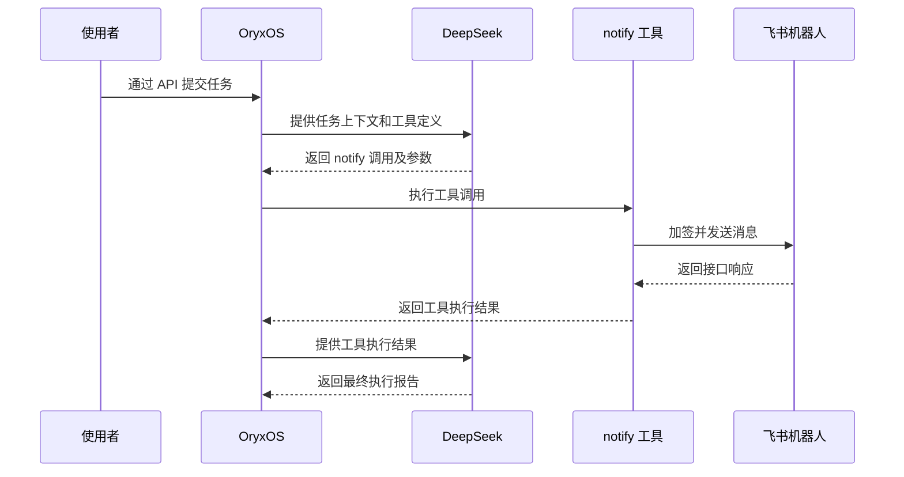

[toc]

# 第一题学习收获与复盘：理解 Agent 执行与工程验证

> 记录日期：2026-10-27。
>
> 对应作业：[第二周第一题](../02-第2周作业.md)。具体配置、命令和执行证据见 [第一题实操记录](./2026-10-27-第一题-OryxOS本地运行与Agent通知实操记录.md)。

第一题最有价值的收获，是理解一个任务如何被 Agent 执行，并学会用证据判断它是否完成。

本次运行的是本机官方源码目录 `/Volumes/Work-Data/work/AI/projects/oryxos` 中的 OryxOS。当前 `oryxos-practice` 仓库负责网站练习与作业记录；本文主要讨论已有平台的使用、集成、排错和验证。

本次实际任务由 `homework-hello` Agent 使用 `deepseek-flash` 模型，通过 `notify` 工具向 `homework-feishu` 渠道发送消息。执行记录 ID 为 `1`，最终状态为 `SUCCESS`，有两次成功的模型调用、一次成功的通知工具调用，并已在飞书群确认收到消息。

## 一、从环境准备中学到工程运行能力

运行一个 Java 项目，需要分清几种工具的职责：

| 工具或目录 | 职责 |
|---|---|
| SDKMAN | 安装和切换 JDK、Maven 的版本 |
| JDK | 提供 Java 编译与运行环境 |
| Maven | 解析依赖、编译、测试和打包 |
| Maven 本地仓库 | 缓存依赖和构建插件 |

软件安装目录和依赖缓存可以分别管理。项目要求的版本、终端当前使用的版本、Maven 实际使用的 JDK，也需要分别确认。

复习时可以通过下面两个命令检查实际环境：

```bash
java -version
mvn -version
```

`mvn -version` 会显示 Maven 使用的 Java 版本和 Java home，可以据此确认构建工具拿到了预期的 JDK。

这部分训练的是把已有工程运行起来的能力：确认版本、理解路径、读取报错、定位配置，并逐步验证每个前提是否成立。

## 二、分清 Provider、Agent、Tool 和通知渠道

本次任务中，这几种配置承担不同职责：

| 对象 | 负责什么 | 本次例子 |
|---|---|---|
| Provider | 连接哪家模型服务，使用什么地址和凭证 | `deepseek` |
| Agent | 定义任务、选择模型、限定可用工具和运行设置 | `homework-hello` |
| Tool | 执行具体动作，并返回执行结果 | `notify` |
| 通知渠道 | 保存投递类型、Webhook、签名等连接配置 | `homework-feishu` |
| OryxOS 运行时 | 读取定义、组织模型调用、调度工具并记录执行过程 | 本机启动的 OryxOS 服务 |

Agent 的任务正文中使用渠道名 `homework-feishu`。执行时，`notify` 工具按名称找到对应配置，再使用其中的 Webhook 和签名密钥发送消息。

任务说明负责表达“向哪个渠道发送什么内容”，投递连接和凭证由渠道配置负责。

本次 Agent 定义保存在 `AGENT.md` 中，包含 Provider、模型、工具范围和任务说明。我们通过文件保存 API 把准备好的定义交给平台，平台校验、写入并注册 Agent。

## 三、看懂最小的 Agent 执行闭环

本次可观察到的交互如下：



第一次模型调用产生了 `notify` 工具调用及其参数，包括渠道名和消息内容。OryxOS 随后执行工具，并把工具返回结果交回模型。第二次模型调用根据这个结果生成最终报告。

因此，一次 Agent 任务可以包含多次模型调用。本次恰好是两次模型调用、一次工具调用、一次消息发送。

这里可以看到 ReAct 的最小闭环：模型生成行动请求，运行时执行行动，获得结果后继续生成响应。模型负责生成调用请求与报告，真实工具操作、执行检查和审计记录由运行时负责。

## 四、理解 API 与管理界面的关系

第一题包含多种操作方式：环境安装、构建和服务启动使用终端命令；飞书机器人和凭证由人在平台准备；OryxOS 中创建渠道、创建 Agent、触发执行和查询结果，主要通过 API 完成。

还可以按调用者分清三类接口：

| 接口 | 谁调用 | 作用 |
|---|---|---|
| OryxOS 管理与执行 API | 使用者、脚本或管理台 | 注册配置、提交任务、查询结果 |
| DeepSeek 模型 API | OryxOS | 获取模型响应，包括工具调用和最终报告 |
| 飞书 Webhook | `notify` 工具的飞书适配器 | 将消息投递到指定群 |

本次使用的 OryxOS 核心接口包括：

| 操作 | 接口 |
|---|---|
| 注册通知渠道 | `POST /api/v1/notify-channels` |
| 创建 Agent 文件并注册 | `POST /api/v1/agents/homework-hello/files` |
| 手动触发任务 | `POST /api/v1/agents/homework-hello/trigger` |
| 查询执行状态 | `GET /api/v1/runs/1` |
| 查询模型、工具审计 | `GET /api/v1/audit/llm`、`GET /api/v1/audit/tool` |

管理界面把配置和调用做成表单、按钮及结果列表，其内部也会请求后端 API。理解这层关系，就可以从界面行为追到请求内容，再追到后端处理逻辑。

本次触发接口先返回执行 ID 和 `RUNNING`，表示任务已经启动。之后通过查询接口取得最终的 `SUCCESS`，再结合审计和收件结果验收。复盘时可以只查询既有执行记录，无需再次触发通知。

## 五、理解配置、进程和凭证的关系

本次不同配置分别承担以下职责：

| 配置 | 职责 |
|---|---|
| `.sdkmanrc` | 指定项目的工具版本 |
| Maven `settings.xml` | 配置本地依赖仓库等构建设置 |
| `.env` | 保存本机准备注入的环境变量 |
| `application.yml` | 描述 OryxOS 的运行与 Provider 配置 |
| `AGENT.md` | 描述某个 Agent 的运行设置与任务 |
| 数据库中的 Provider、通知渠道 | 保存已经注册的连接配置 |

`.env` 文件中的变量需要加载到进程环境中。本次启动脚本不会自动读取 `.env`，因此先通过 `source ./.env` 加载，文件中的 `export` 再让后续启动的 Java 子进程继承变量。

Provider 配置还有一个需要注意的行为：YAML 在首次启动时用于播种数据库；同名 Provider 已存在时，启动不会直接覆盖它。因此，轮换已注册的模型凭证时，需要同步更新 Provider 记录。

凭证管理也是这次练习的一部分：真实凭证外部注入，落库时加密，查询时脱敏。Git 中保存文档和空值示例，本次真实环境文件、密钥与运行数据库保存在本机。

## 六、用分层证据判断任务是否完成

验收可以分为五层：

| 层次 | 要回答的问题 | 本次证据 |
|---|---|---|
| 构建 | 项目是否生成了运行产物？ | Maven `BUILD SUCCESS` 和 JAR 产物 |
| 启动 | 服务是否实际就绪？ | 健康接口成功、端口监听、管理台可打开 |
| 模型调用 | 是否真正调用了模型？ | 两条成功的 LLM 审计记录 |
| 工具执行 | 是否真正执行了通知工具？ | 一条成功的 `notify` 审计及对应运行事件 |
| 通知送达 | 指定群是否实际收到消息？ | 群内人工收件确认 |

这些证据分别回答不同的问题。模型列表接口用于检查连接和鉴权；真实对话推理由执行审计验证。工具审计提供执行结果，群内收件进一步确认消息实际可见。

遇到失败时，可以按“环境与配置 → 服务状态 → Provider → Agent 定义 → 执行记录 → 工具审计 → 实际收件”的顺序定位，逐步缩小范围。

这部分训练的是工程判断：区分已经确认的事实、尚未验证的假设，以及下一步需要补充的证据。

## 七、从实际使用中发现可以贡献的问题

配置飞书渠道时，管理台没有签名密钥输入框，而后端已有 `config.secret` 能力。进一步检查编辑请求和后端保存逻辑，又发现未提交签名配置时可能覆盖原密钥。

这条发现路径是：

`实际使用遇到障碍 → 对照界面与 API → 阅读保存逻辑 → 明确触发条件 → 编写回归测试 → 修复`。

它把“会使用平台”推进到“能解释问题并验证修复”。后续过程记录在 [第二题飞书签名密钥修复与 PR 实操记录](./2026-10-27-02-第二题-飞书签名密钥修复与PR实操记录.md) 中，PR 提交仍待完成。

## 八、复习时尝试回答的问题

1. SDKMAN、JDK、Maven 和本地依赖仓库分别负责什么？
2. Provider、Agent、Tool、通知渠道分别在哪里发挥作用？
3. 为什么这次有两次模型调用，却只发送了一条消息？
4. `notify` 如何根据 `homework-feishu` 找到实际飞书机器人？
5. 触发接口返回 `RUNNING` 后，还需要查询和确认什么？
6. 为什么修改 `.env` 后，数据库里已注册的 Provider 凭证可能仍是原值？
7. 如何从执行记录、审计和群内消息证明整条链路已经完成？

复习目标是能够用自己的语言讲清这条执行链路，并找到每一个关键结论对应的证据。
