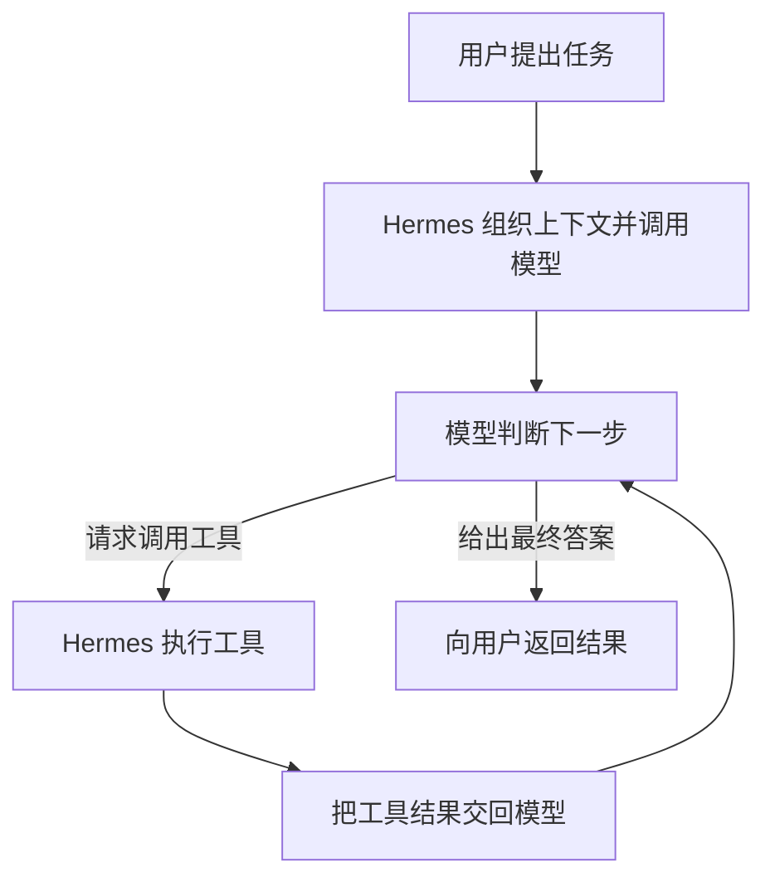

[toc]

# 第三题：Hermes Agent 对话学习笔记

> 日期：2026-10-28。
>
> 来源：阅读官方功能概览后，与 AI 围绕具体任务展开的问答。
>
> 本文记录概念理解和推演过程；这些问答不代表已经安装、运行或验证 Hermes。第三题仍需要实际运行，并从功能、技术架构、企业价值三个角度与 OryxOS 对比。

## 一、为什么读完功能概览却觉得没记住

我的起点是：

> 我已经读了官方功能概览，我觉得我什么都没记住。

功能概览提供了一张能力地图，但第一次阅读时，模型、工具、Memory、Skills 等名称还没有对应到具体操作。

这次调整了学习方式：围绕“读取学习笔记、总结并保存文件”这个任务，每次只理解一个概念，再用自己的话回答问题。

## 二、Agent 怎样组织模型和工具完成任务

示例需求：

> 读取当前目录里的学习笔记，总结成三点，并保存到一个新文件中。

这个任务涉及三个角色：

| 角色 | 负责的事情 | 示例 |
|---|---|---|
| 模型，例如 DeepSeek | 理解需求、判断下一步、生成内容 | 决定先读取笔记，再生成总结 |
| Tool（工具） | 执行具体操作 | 读取文件、创建目录、写入文件 |
| Hermes 的 Agent 程序 | 组织模型调用和工具执行，将结果反馈给模型 | 根据模型的工具调用请求执行操作，再继续处理 |

我的回答：

> hermes自主完成多轮的调用，并会根据 DeepSeek 的决定，调用工具

还需要补上关键一环：**工具执行后的结果会交回模型，成为下一轮判断的依据。**

这个反复进行的过程称为 **Agent 执行循环（Agent Loop）**。下面是用于理解它的简化流程：

工具返回的内容包括读取到的数据、执行成功的信息，也包括错误信息。

## 三、错误反馈怎样影响下一步行动

追问：

> 如果写入文件的工具返回“目标目录不存在”，Hermes 接下来应该怎么做？

我的回答：

> Hermes 会把目录不存在的错误返回给 DeepSeek，再根据 DeepSeek 的决定调用工具创建目录，然后重新保存文件。

这是一条合理的处理路径：

1. 写文件工具返回“目录不存在”。
2. Hermes 将错误交回 DeepSeek。
3. DeepSeek 根据错误决定请求创建目录。
4. Hermes 调用相应工具，并反馈创建结果。
5. 根据模型后续决定重新保存文件，再检查保存结果。

这里最重要的理解是：**执行 → 获取反馈 → 再决策。** 创建目录是这个示例中的一种处理方式，具体行动由当前任务、反馈和可用能力共同决定。

## 四、Memory：哪些信息值得跨会话保留

示例偏好：

> 我在学习 AI 工程，讲解时请使用中文，先解释原理，再给操作步骤。

希望这个偏好在全新的会话里仍然生效，就需要把相关信息保存下来，并在后续对话中读取、提供给模型。这是跨会话记忆的基本作用。

问答中比较了两条信息：

| 信息 | 我的判断 | 理由 |
|---|---|---|
| A：习惯“先理解原理，再动手实践” | 更值得长期保存 | 是稳定的学习偏好，后续任务仍可能用到 |
| B：本次保存文件时，第一次调用工具返回“目录不存在” | 更适合保留在本次执行记录里 | 是一次具体任务中的事件 |

我选择了 **A**。

**Memory 的重点，是保留以后仍有用的信息。** 一次错误可以留在执行记录里；从错误中提炼出的通用做法，则可能进一步整理为 Skill。

## 五、Skill：把操作经验整理成可复用的方法

Skill 可以理解为一份可复用的操作说明。例如，整理学习笔记的方法可以写成：

> 读取指定笔记 → 按“已完成、遇到的问题、下一步”分类 → 生成 Markdown → 保存并检查文件。

以后遇到类似任务，Hermes 可以按需读取相关 Skill，再通过模型决策和工具执行完成操作。

追问：

> “每次生成复盘，都要检查是否遗漏了原笔记中的问题”，这条要求更适合放在整理笔记的 Skill 里，还是作为个人 Memory？

我的回答：

> 因为这是某次操作经验，与特定的场景相关，所以放到整理笔记的Skill中更合适

进一步提炼：**这是一条以后每次整理笔记都要执行的检查步骤，属于可复用的方法，所以适合放入 Skill。** 判断重点在于它能否指导同类任务的后续执行。

## 六、把几个概念放到同一个任务中

| 概念 | 在“整理学习笔记”中的作用 |
|---|---|
| Memory | 提供“使用中文、先讲原理再给步骤”等个人偏好 |
| Skill | 提供分类、整理、检查遗漏等操作方法 |
| 模型 | 结合需求、偏好、方法和执行结果，判断下一步并生成内容 |
| Tool | 实际读取、写入文件等 |
| Agent Loop | 持续组织模型与工具之间的调用和反馈 |

把这些能力放在一起，可以这样理解：

> 用户要求整理笔记 → Hermes 使用相关记忆和 Skill → 模型决定下一步 → 工具执行 → 执行结果交回模型 → 继续处理和检查 → 返回结果。

这是概念上的配合关系，不要求每个任务都使用全部能力；具体加载和执行方式要在实操时观察。

## 七、本次学习方法与下一步

本次对话采用的方法是：

1. 用一个具体任务承载抽象概念。
2. 每次只增加一个概念。
3. 用自己的话回答，检查是否真正理解。
4. 加入“目录不存在”这样的变化，检验能否解释反馈过程。
5. 用实例区分 Memory、Skill 和 Tool，再把它们串起来。

目前已经能够解释 Agent 的执行循环，以及 Memory、Skill、Tool 的不同作用。

下一步用实际操作验证：让 Hermes 整理一份学习笔记，观察工具调用和生成文件；验证学习偏好能否跨会话使用；将整理方法保存成 Skill，并换一份笔记检验复用效果。以上均为待开展的实践，不写成已完成结果。

回顾时可以先不看正文，尝试回答：

- Hermes 相比单独调用模型，多组织了哪些工作？
- 工具执行失败后，错误信息如何影响下一轮决策？
- 哪些信息适合长期记忆，哪些更适合任务记录？
- 一条操作经验在什么情况下适合整理为 Skill？
- 如何通过实际文件和调用结果，确认任务确实完成？

## 八、相关文档

- [第二周作业](../02-第2周作业.md)：第三题的完整要求。
- [Hermes 官方功能概览](https://hermes-agent.nousresearch.com/docs/user-guide/features/overview)：回看能力地图。
- [Agent 架构](https://hermes-agent.nousresearch.com/docs/developer-guide/architecture)：进一步了解执行流程。
- [Persistent Memory](https://hermes-agent.nousresearch.com/docs/user-guide/features/memory)：跨会话记忆。
- [Skills System](https://hermes-agent.nousresearch.com/docs/user-guide/features/skills)：按需加载和复用操作方法。
